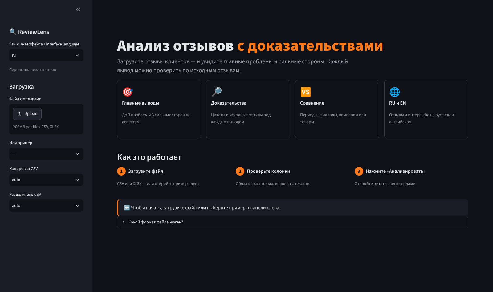
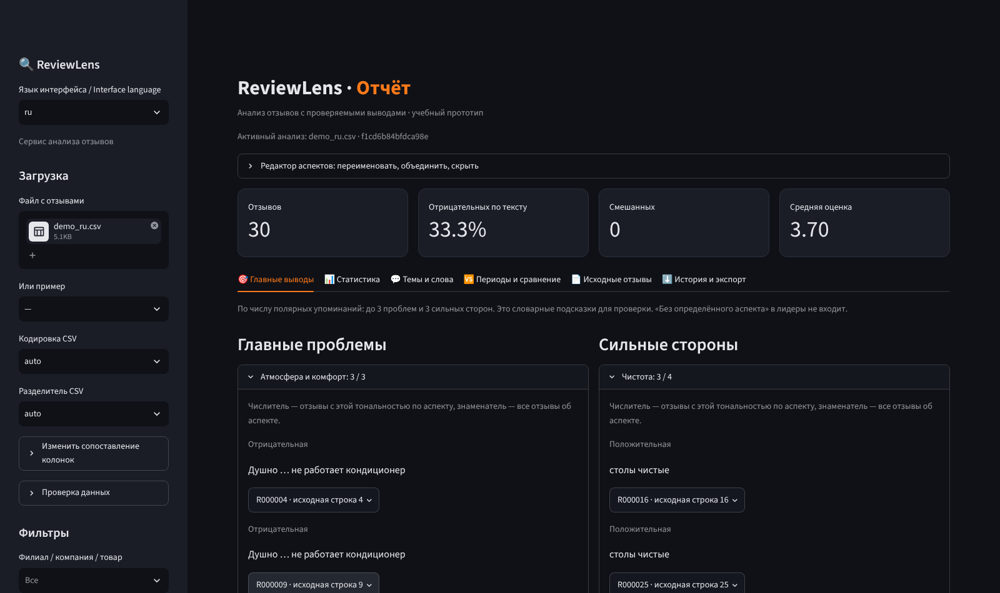
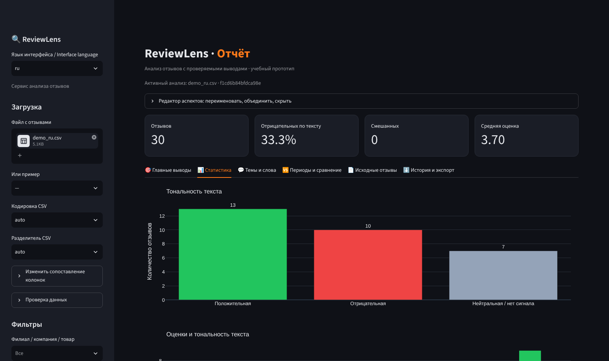

**English** | [Русский](README.ru.md)

# ReviewLens

**Review analytics with traceable findings.** ReviewLens turns a pile of customer reviews into a short list of problems and strengths — and every finding links back to the exact reviews it is based on.

> Educational prototype built for the course *Entrepreneurship in Information Technology* (Belarusian State University). Runs locally, no accounts, no external APIs.



## Features

- **Main findings** — up to 3 problems and 3 strengths by aspect (food, service, price, delivery, cleanliness, …).
- **Evidence for every finding** — counts, quotes and one click to the full source review with its row number.
- **Text sentiment independent of stars** — Positive, Negative, Neutral and Mixed; reviews whose rating contradicts the text are flagged.
- **Russian and English** — both review languages and a bilingual interface.
- **Flexible import** — CSV or XLSX, automatic encoding and delimiter detection, manual column mapping; only the text column is required.
- **Aspect editor** — rename, merge and hide aspects; industry templates (general, food service, e-commerce, services).
- **Comparison** — two time periods with an alert on growing negative share; up to four branches, companies or products.
- **Topics** — TF-IDF + MiniBatchKMeans clustering (optional multilingual embeddings), frequent bigrams, word cloud.
- **Export** — summary report, aspect statistics, mentions with quotes, analyzed reviews, “finding is wrong” feedback.

| Main findings | Statistics |
| --- | --- |
|  |  |

## Quick start

Requires **Python 3.10+** (tested on 3.12–3.14, Windows).

**Windows, one click:** run `start.cmd` — it creates a virtual environment, installs dependencies and opens the app.

**Manual setup:**

```bash
python -m venv .venv
# Windows: .venv\Scripts\activate    Linux/macOS: source .venv/bin/activate
pip install -r requirements.txt
streamlit run app.py
```

The app opens at `http://localhost:8501`. Pick **RU demo** / **EN demo** in the sidebar or upload your own file.

## Input format

One row per review, header in the first row. Only the review text is required.

| Field | Required | Notes |
| --- | --- | --- |
| Review text | yes | Russian or English |
| Rating | no | Integer 1–5; never used to determine text sentiment |
| Date | no | ISO preferred: `2026-10` or `2026-10-15` |
| Branch / company / product | no | Filters and group comparison |
| Reviewer location | no | Filters and statistics |
| Source ID, review URL | no | Kept for traceability |

A ready-made template is available on the home screen and in [`data/template.csv`](data/template.csv).

## How it works

1. **Import & validation** — encoding/delimiter detection, column mapping; only rows without any letters are removed.
2. **Sentiment** — English: VADER; Russian: a compact stemmed lexicon with negation rules.
3. **Aspects** — bilingual keyword templates; each review is split into clauses, so *“tasty food, but rude staff”* yields different sentiment for food and service.
4. **Findings** — aspects ranked by the number of polar reviews, each with quotes and links to the source rows.
5. **Topics** — TF-IDF + MiniBatchKMeans by default; optional local Sentence Transformers model for semantic clustering.

The approach is an explainable baseline, not a neural aspect-sentiment model: irony, slang and complex negation can cause errors, which is why every finding comes with evidence to check. See [`validation/RESULTS.md`](validation/RESULTS.md) for test and evaluation results and [`docs/design-notes.ru.md`](docs/design-notes.ru.md) for design decisions and limitations (in Russian).

## Project structure

```
ReviewLens/
├── app.py                    # Streamlit interface (entry point)
├── reviewlens/               # core package
│   ├── data_io.py            # file import, column mapping, validation, export
│   ├── nlp.py                # cleaning, sentiment, topics, bigrams, word cloud
│   ├── aspects.py            # aspect templates, clauses, editor, statistics
│   ├── reporting.py          # findings, summary report, period comparison
│   └── style.py              # UI theme: colors, CSS, chart style
├── scripts/                  # evaluation and optional model tools
├── tests/                    # unit and Streamlit AppTest tests
├── data/                     # demo files, template, evaluation samples, datasets
├── validation/               # recorded test and evaluation results
├── docs/                     # screenshots, design notes
├── .streamlit/config.toml    # dark theme
├── requirements.txt          # core dependencies
└── requirements-embeddings.txt  # optional: semantic clustering
```

## Tests and evaluation

```bash
python -m unittest discover -s tests -v      # 14 tests: core logic + UI in both languages
python -m scripts.evaluate                    # sentiment and aspect quality on labeled samples
python -m scripts.validate_datasets           # full run on datasets in data/datasets/
```

`validate_datasets` also uses the [Disneyland Reviews](https://www.kaggle.com/datasets/arushchillar/disneyland-reviews) dataset if you place `DisneylandReviews.csv` into `data/datasets/` (not included in the repository because of its size — download it from Kaggle and check the dataset license there).

## Optional: semantic clustering

```bash
pip install -r requirements-embeddings.txt
python -m scripts.prepare_model               # one-time download of a multilingual model
```

Then choose **embeddings** in the *Topics* tab and enter the absolute path to `models/paraphrase-multilingual-MiniLM-L12-v2`. The app never downloads models on its own.

## Roadmap

- User accounts and saved analysis history
- Weekly digests and alerts
- Import via official platform APIs where available
- Neural aspect-based sentiment for Russian and English

## Team

- **Yaroslav Prokhorenkov** — co-founder, CTO: NLP module, interface, models, Russian language support
- **Mikhail Kuzmichkin** — co-founder, CEO/CFO: market and competitor research, financial model, monetization

## License

Not specified yet.
