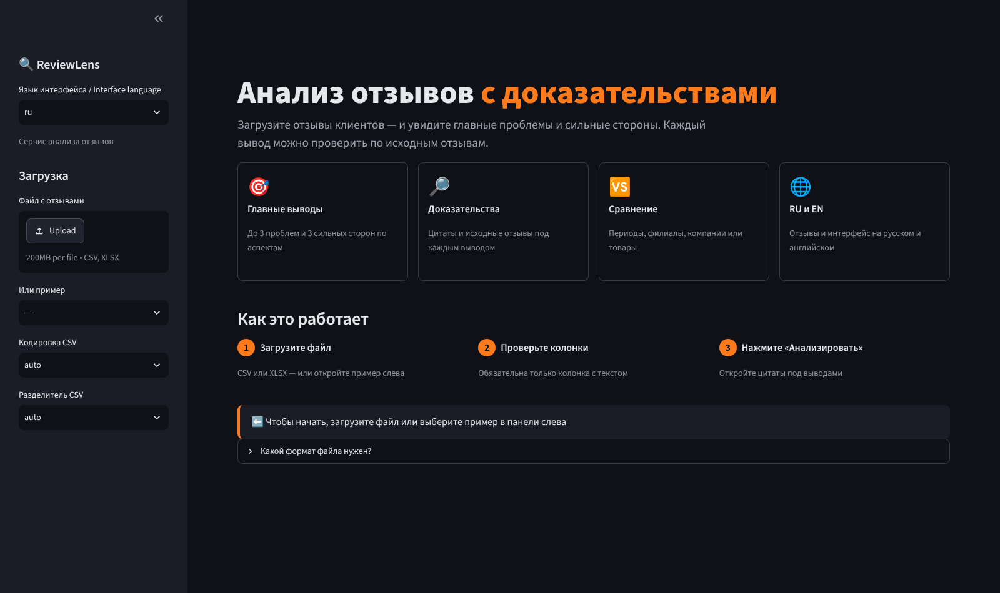
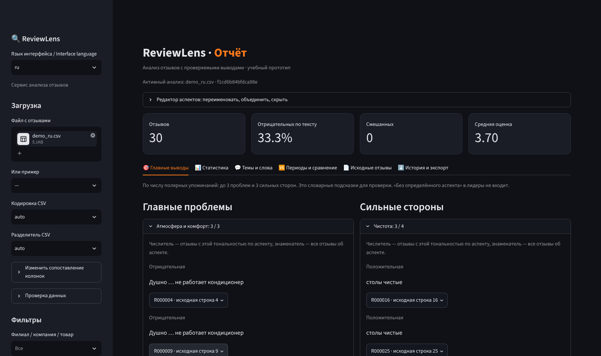
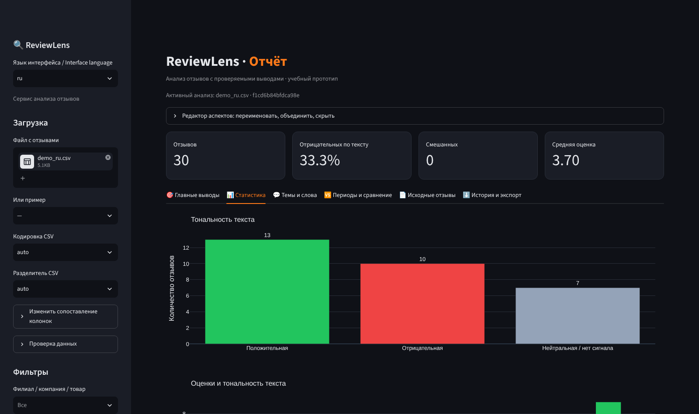

[English](README.md) | **Русский**

# ReviewLens

**Аналитика отзывов с проверяемыми выводами.** ReviewLens превращает массив клиентских отзывов в короткий список проблем и сильных сторон, и каждый вывод ведёт к конкретным отзывам, на которых он основан.

> Учебный прототип для дисциплины «Предпринимательство в сфере информационных технологий» (БГУ). Работает локально, без аккаунтов и внешних API.



## Возможности

- **Главные выводы** — до 3 проблем и 3 сильных сторон по аспектам (еда, обслуживание, цена, доставка, чистота и т.д.).
- **Доказательства у каждого вывода** — счётчики, цитаты и переход к полному исходному отзыву с номером строки.
- **Тональность текста независимо от звёзд** — положительная, отрицательная, нейтральная и смешанная; отзывы, где оценка противоречит тексту, отмечаются.
- **Русский и английский** — оба языка отзывов и двуязычный интерфейс.
- **Гибкий импорт** — CSV или XLSX, автоопределение кодировки и разделителя, ручное сопоставление колонок; обязателен только текст.
- **Редактор аспектов** — переименование, объединение, скрытие; шаблоны отраслей (общий, общепит, e-commerce, услуги).
- **Сравнение** — два периода с сигналом о росте доли негатива; до четырёх филиалов, компаний или товаров.
- **Темы** — кластеризация TF-IDF + MiniBatchKMeans (по желанию — мультиязычные эмбеддинги), частые словосочетания, облако слов.
- **Экспорт** — краткий отчёт, статистика аспектов, упоминания с цитатами, разобранные отзывы, замечания «вывод неверен».

| Главные выводы | Статистика |
| --- | --- |
|  |  |

## Быстрый старт

Нужен **Python 3.10+** (проверено на 3.12–3.14, Windows).

**Windows в один клик:** запустите `start.cmd` — он создаст виртуальное окружение, установит зависимости и откроет приложение.

**Вручную:**

```bash
python -m venv .venv
# Windows: .venv\Scripts\activate    Linux/macOS: source .venv/bin/activate
pip install -r requirements.txt
streamlit run app.py
```

Приложение откроется по адресу `http://localhost:8501`. Выберите **RU demo** / **EN demo** в боковой панели или загрузите свой файл.

## Формат файла

Одна строка — один отзыв, заголовок в первой строке. Обязателен только текст отзыва.

| Поле | Обязательно | Примечание |
| --- | --- | --- |
| Текст отзыва | да | Русский или английский |
| Оценка | нет | Целое число 1–5; на тональность текста не влияет |
| Дата | нет | Лучше ISO: `2026-10` или `2026-10-15` |
| Филиал / компания / товар | нет | Фильтры и сравнение групп |
| Локация автора | нет | Фильтры и статистика |
| Исходный ID, ссылка на отзыв | нет | Сохраняются для проверки |

Шаблон можно скачать на главной странице или взять в [`data/template.csv`](data/template.csv).

## Как это работает

1. **Импорт и проверка** — определение кодировки и разделителя, сопоставление колонок; удаляются только строки совсем без букв.
2. **Тональность** — английский: VADER; русский: компактный словарь со стеммингом и правилами отрицаний.
3. **Аспекты** — двуязычные словари ключевых слов; отзыв делится на фрагменты, поэтому «еда вкусная, но персонал грубый» даёт разную тональность еды и обслуживания.
4. **Выводы** — аспекты ранжируются по числу полярных отзывов, у каждого есть цитаты и ссылки на исходные строки.
5. **Темы** — по умолчанию TF-IDF + MiniBatchKMeans; по желанию — локальная модель Sentence Transformers для смысловой группировки.

Это объяснимый базовый подход, а не нейросетевая модель аспектной тональности: ирония, сленг и сложные отрицания могут давать ошибки, поэтому у каждого вывода есть доказательства для проверки. Результаты тестов и оценки качества — в [`validation/RESULTS.md`](validation/RESULTS.md), подробные проектные решения и ограничения — в [`docs/design-notes.ru.md`](docs/design-notes.ru.md).

## Структура проекта

```
ReviewLens/
├── app.py                    # интерфейс Streamlit (точка входа)
├── reviewlens/               # основной пакет
│   ├── data_io.py            # импорт файлов, сопоставление колонок, проверка, экспорт
│   ├── nlp.py                # очистка, тональность, темы, биграммы, облако слов
│   ├── aspects.py            # шаблоны аспектов, фрагменты, редактор, статистика
│   ├── reporting.py          # выводы, краткий отчёт, сравнение периодов
│   └── style.py              # оформление: цвета, CSS, стиль графиков
├── scripts/                  # оценка качества и инструменты для модели
├── tests/                    # модульные тесты и тесты интерфейса (AppTest)
├── data/                     # демо-файлы, шаблон, выборки для оценки, датасеты
├── validation/               # сохранённые результаты тестов и оценки
├── docs/                     # скриншоты, проектные заметки
├── .streamlit/config.toml    # тёмная тема
├── requirements.txt          # основные зависимости
└── requirements-embeddings.txt  # необязательно: смысловая кластеризация
```

## Тесты и оценка качества

```bash
python -m unittest discover -s tests -v      # 14 тестов: логика и интерфейс на двух языках
python -m scripts.evaluate                    # качество тональности и аспектов на размеченных примерах
python -m scripts.validate_datasets           # полный прогон датасетов из data/datasets/
```

`validate_datasets` также использует датасет [Disneyland Reviews](https://www.kaggle.com/datasets/arushchillar/disneyland-reviews), если положить `DisneylandReviews.csv` в `data/datasets/`. В репозиторий он не входит из-за размера: скачайте его с Kaggle и проверьте там лицензию.

## Необязательно: смысловая кластеризация

```bash
pip install -r requirements-embeddings.txt
python -m scripts.prepare_model               # однократная загрузка мультиязычной модели
```

Затем во вкладке «Темы и слова» выберите **embeddings** и укажите абсолютный путь к папке `models/paraphrase-multilingual-MiniLM-L12-v2`. Само приложение модели не скачивает.

## Планы развития

- Аккаунты и сохранённая история анализов
- Еженедельные дайджесты и уведомления
- Импорт через официальные API площадок, где они доступны
- Нейросетевая аспектная тональность для русского и английского

## Команда

- **Ярослав Прохоренков** — сооснователь, CTO: NLP-модуль, интерфейс, модели, поддержка русского языка
- **Михаил Кузьмичкин** — сооснователь, CEO/CFO: исследование рынка и конкурентов, финансовая модель, монетизация

## Лицензия

Пока не выбрана.
